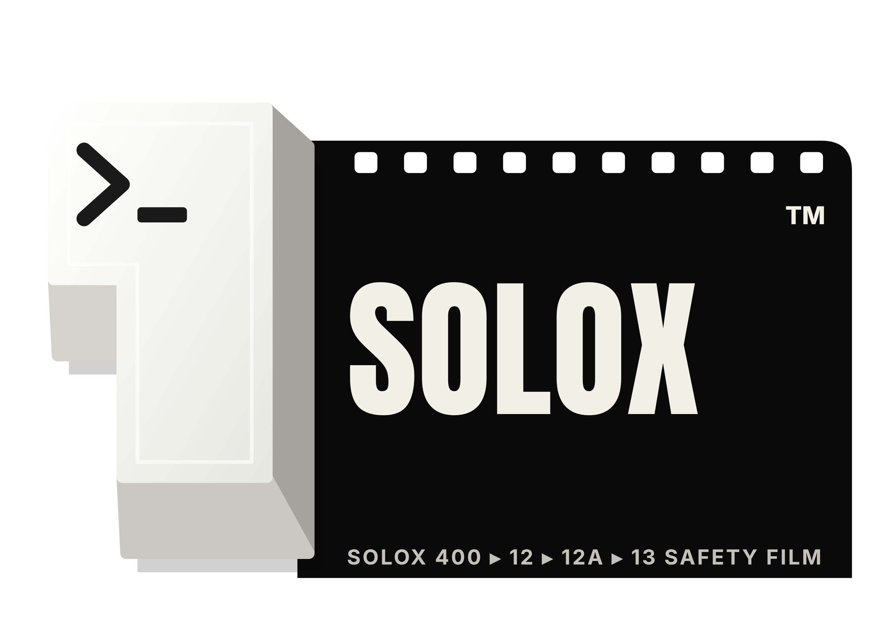
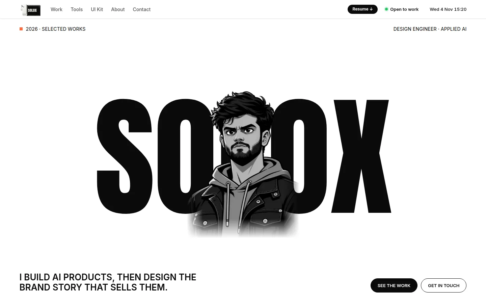
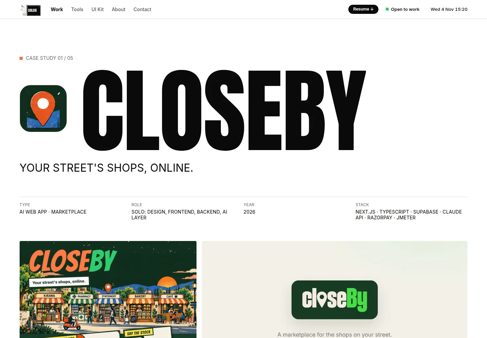

<p align="center">
  
</p>

<h1 align="center">SOLOX · Aman Kumar Chhari</h1>

<p align="center">
  <b>Design Engineer · Applied AI</b><br>
  I build AI products, then design the brand story that sells them. One person, from the client's problem to the launch poster.
</p>

<p align="center">
  <a href="https://amankumarchhari.vercel.app">Live site</a> ·
  <a href="https://github.com/chhari07">GitHub</a> ·
  <a href="https://www.linkedin.com/in/aman-kumar-chhari-9613bb235/">LinkedIn</a> ·
  <a href="mailto:amankumarchhari@gmail.com">Email</a>
</p>



## What this is

My portfolio, rebuilt as one site. It merges my earlier full-stack site with my SOLOX design site:

- **From SOLOX:** the black-and-white look, big Anton type, colour only on hover, posters, brand films, Tools and UI Kit pages.
- **From the full-stack site:** the Mac-style menu bar, the tech dock, how I build AI with guardrails, design decisions, failure handling and Apache JMeter load-test tables in every case study, plus experience and certificates.

Every number on the site is measured (JMeter runs, eval files, real repos), not estimated.

## Pages

| Page | What's on it |
|---|---|
| `/` | Hero, what I do (5 steps), selected work, measured results, how I build AI, posters and films, tools, experience, roles, contact |
| `/work/[slug]` | Case studies: CloseBy, Stack, ScanCart.ai, Streetwise, Orderly. Problem, what I built, brand story, numbers, decisions, failure handling, JMeter results |
| `/tools`, `/tools/[slug]` | Apps I built for my own phone and desktop: Wakeface, OTG Switch, GitHub Widgets, Mac Bar, Mac Notch, Mac Snap |
| `/ui-kit` | Open-source Ubuntu Mac Kit and Ubuntu Widgets, with one-command installs, plus the SOLOX design system |
| `/about` | About me, what I'm looking for, experience, certificates, skills, principles |
| `/contact` | Contact form (opens your email app, no backend) and links |



## Selected work

| Project | What it is | Links |
|---|---|---|
| CloseBy | AI marketplace for neighbourhood shops, with one gateway for every model call | [Live](https://closeby-ashy.vercel.app) · [Code](https://github.com/chhari07/closeby) |
| Stack | Local-first reading app (web + Android) with spaced review of highlights | [Live](https://stack-henna-delta.vercel.app) · [Code](https://github.com/chhari07/stackforge) |
| ScanCart.ai | Chrome extension + Android app: parallel checks behind one Trust Score, open source | [Live](https://scancart-ai.vercel.app) · [Code](https://github.com/chhari07/scancart-ai) |
| Streetwise | Four Fetch.ai agents for local buying, one QR per shop | [Code](https://github.com/chhari07/streetwise-agents) |
| Orderly | WhatsApp bot + owner app for kirana shops | [Live](https://orderly-blue.vercel.app) |

## The logo

A mechanical-keyboard Enter key with a `>_` terminal prompt, pulling out a film strip that reads SOLOX: press Enter, and the story rolls out. It's an inline SVG (`src/components/solox-logo.tsx`), so it stays sharp at any size. High-resolution files are in [`public/brand/`](public/brand).

## Built with

Next.js 16 (App Router, static pages) · React 19 · TypeScript · plain CSS · `next/font` (Anton + Inter) · Vercel

## Run it

```bash
npm install
npm run dev            # http://localhost:3000
npm run build && npm start
```

## Edit the content

All text lives in data files, not in components:

- `src/content/portfolio.ts`: name, roles, projects, proof numbers, experience, skills, certificates
- `src/content/tools.ts`: tools and UI kits
- `src/content/fullstack.ts`: deep case-study data (decisions, failures, JMeter tables)

## Earlier version

The previous full-stack site is kept at the git tag [`fullstack-v1`](https://github.com/chhari07/amankumarchhari/tree/fullstack-v1).
